<div align="center">

# ✅ TASKORA

**Vos tâches, en toute sérénité.**

Une application web de gestion **personnelle** de tâches : claire, élégante, en mode clair ou sombre, sur ordinateur, tablette et téléphone.


</div>

---

## Sommaire

**Partie 1 — Pour tout le monde**
1. [Qu'est-ce que TASKORA ?](#1-quest-ce-que-taskora-)
2. [Aperçu en images](#2-aperçu-en-images)
3. [Installer TASKORA pas à pas (sans être développeur)](#3-installer-taskora-pas-à-pas-sans-être-développeur)
4. [Guide d'utilisation](#4-guide-dutilisation)
5. [Problèmes fréquents](#5-problèmes-fréquents)
6. [Vos données](#6-vos-données)

**Partie 2 — Documentation technique**

7. [Architecture et technologies](#7-architecture-et-technologies)
8. [Installation manuelle et configuration](#8-installation-manuelle-et-configuration)
9. [API REST](#9-api-rest)
10. [Sécurité](#10-sécurité)
11. [Modèle de données](#11-modèle-de-données)
12. [Tests et qualité](#12-tests-et-qualité)
13. [Exploitation : scripts, sauvegarde, mise en production](#13-exploitation--scripts-sauvegarde-mise-en-production)
14. [Documents du projet](#14-documents-du-projet)

---

# Partie 1 — Pour tout le monde

## 1. Qu'est-ce que TASKORA ?

TASKORA vous aide à **noter, organiser et terminer** ce que vous avez à faire. Chaque personne crée son propre compte et ne voit **que ses propres tâches**.

Ce que vous pouvez faire :

| | Fonctionnalité |
|---|---|
| 📝 | Créer une tâche avec un titre, une description, une **priorité** (Basse, Moyenne, Haute) et une **date d'échéance** si vous le souhaitez |
| 🔄 | Suivre son avancement avec trois **statuts** : À faire, En cours, Terminée |
| 📊 | Voir d'un coup d'œil votre **tableau de bord** : nombre de tâches, progression en %, répartition, tâches prioritaires et tâches **en retard** |
| 📋 | Parcourir vos tâches en **Liste** (avec recherche, filtres et tri) ou en **Kanban** (colonnes que l'on réorganise par glisser-déposer) |
| 🌗 | Choisir le **mode clair, sombre** ou suivre automatiquement le réglage de votre ordinateur |
| 📱 | Utiliser l'application sur **ordinateur, tablette ou téléphone** |
| 🔒 | Gérer votre **profil** : nom, adresse e-mail, mot de passe |

> Une tâche est « en retard » uniquement si elle **n'est pas terminée** et que sa date d'échéance est **passée**. Les tâches terminées restent consultables : rien ne disparaît tout seul.

## 2. Aperçu en images

### Connexion et inscription

| Mode clair | Mode sombre |
|---|---|
|  |  |
|  |  |

### Tableau de bord

| Mode clair | Mode sombre |
|---|---|
|  | 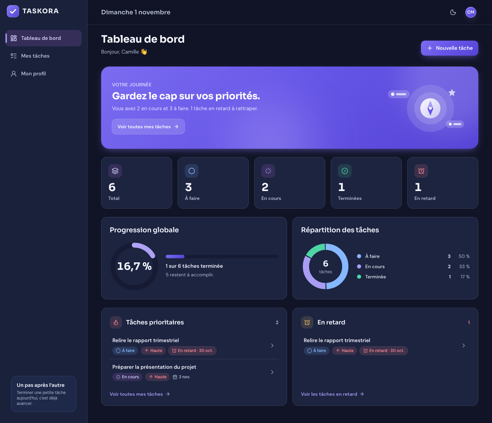 |

### Mes tâches — vue Liste et vue Kanban

| Mode clair | Mode sombre |
|---|---|
| 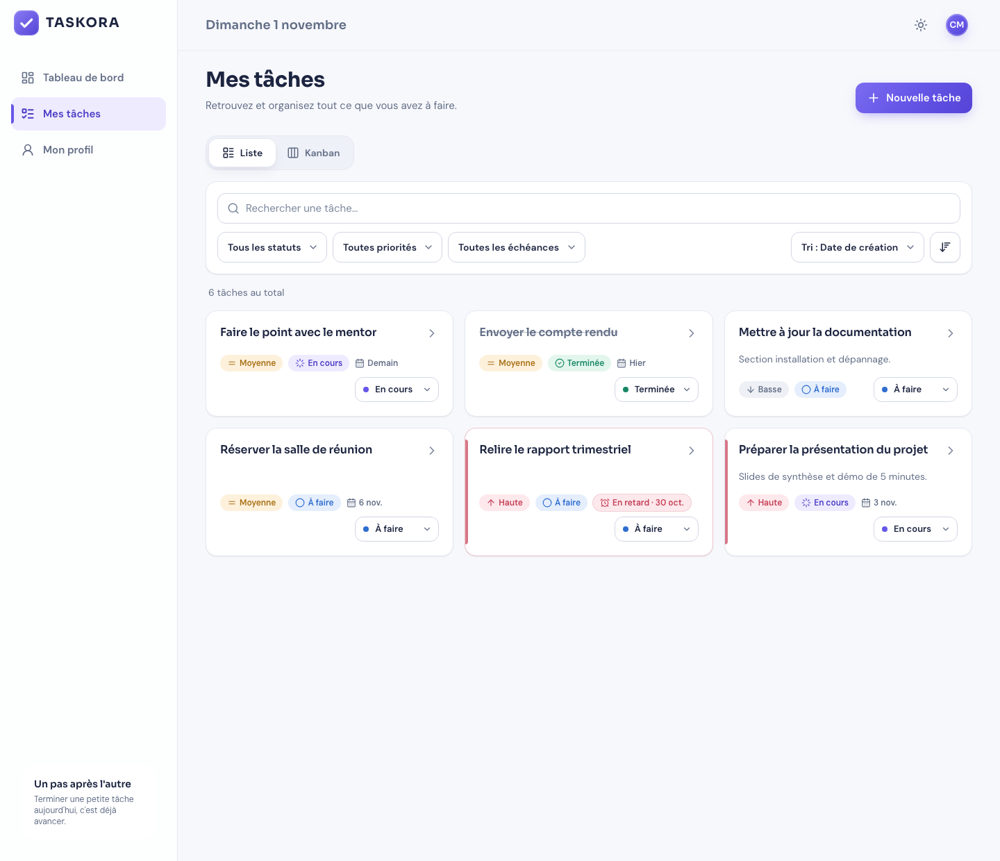 | 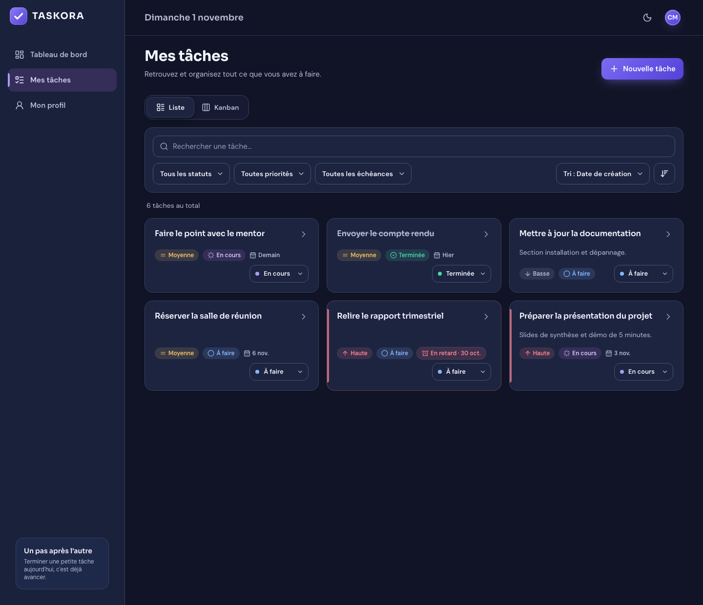 |
| 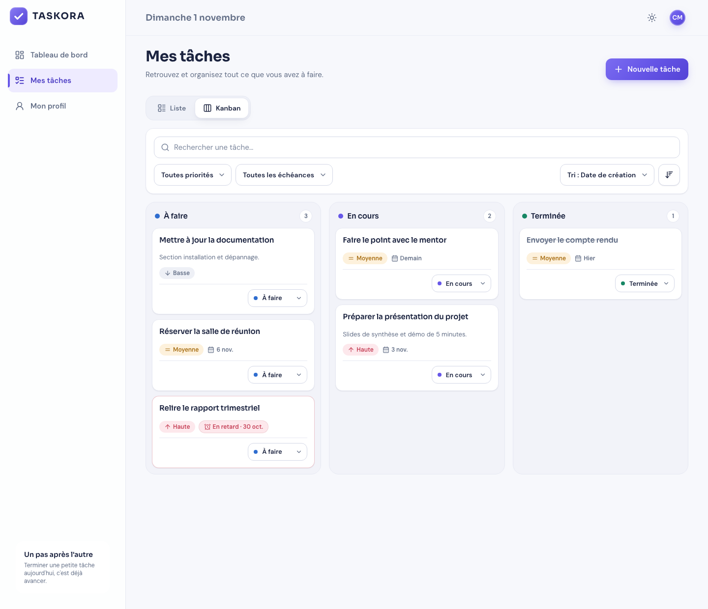 | 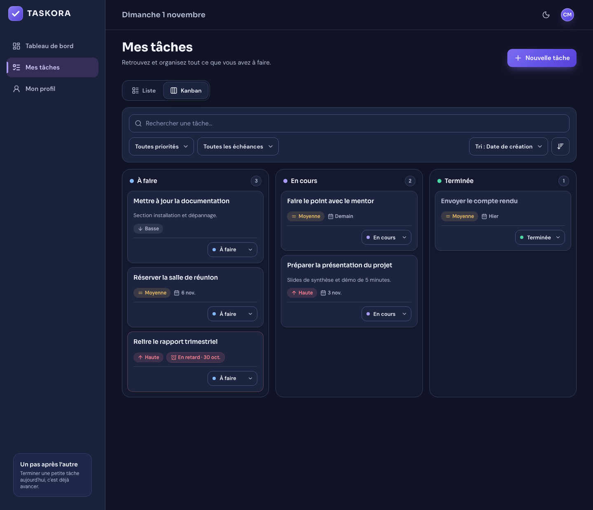 |

### Créer, consulter et modifier une tâche

| Nouvelle tâche | Détails / modification |
|---|---|
| 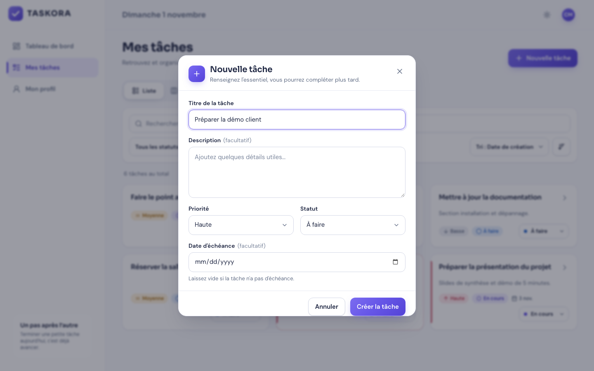 | 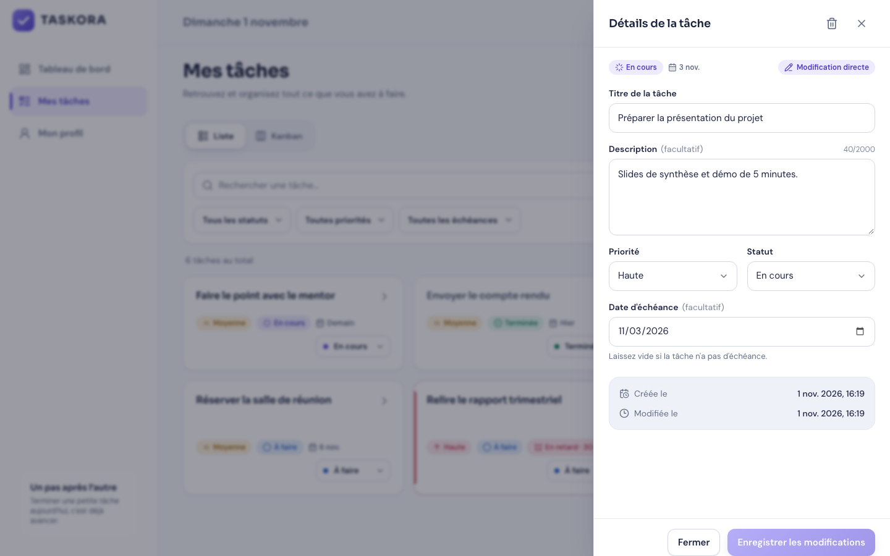 |
| 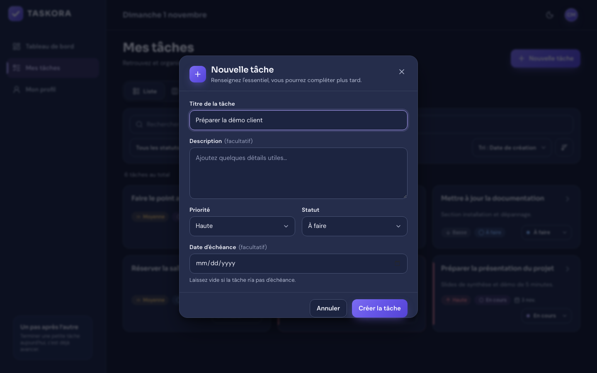 | 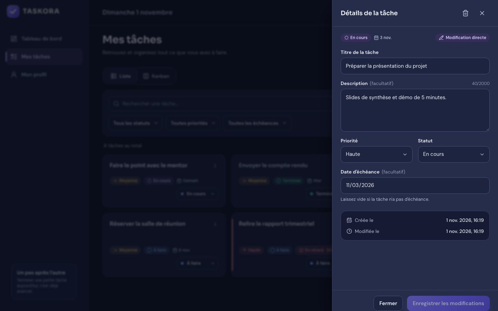 |

### Mon profil et recherche sans résultat

| Mon profil | Aucune tâche trouvée |
|---|---|
|  |  |

### Sur téléphone et tablette

| Connexion | Tableau de bord | Kanban (défilement horizontal) | Liste |
|---|---|---|---|
|  |  | 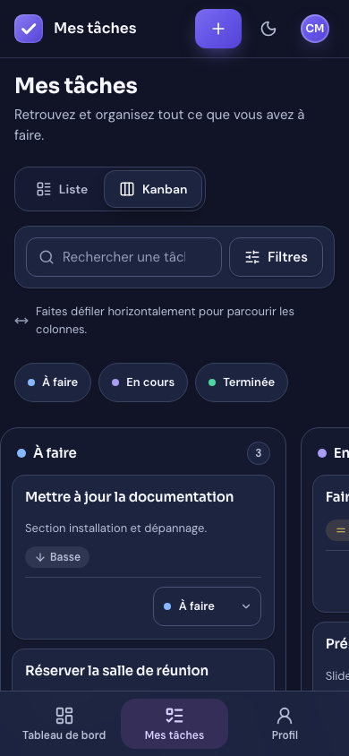 | 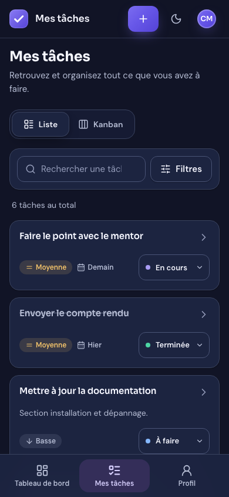 |

| Tablette — Kanban | Tablette — Profil (sombre) |
|---|---|
| 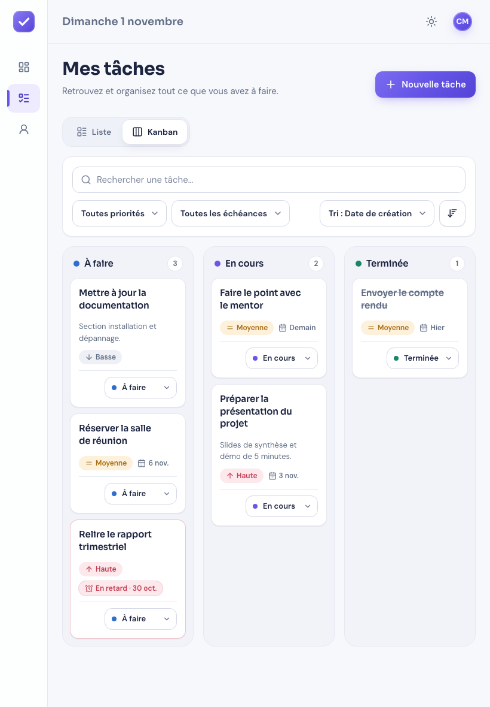 |  |

> Toutes les captures (clair/sombre × ordinateur/tablette/téléphone) sont dans [`docs/screenshots/`](docs/screenshots/).

## 3. Installer TASKORA pas à pas (sans être développeur)

TASKORA s'installe **sur votre propre ordinateur** (Mac, Windows ou Linux). Comptez 5 à 10 minutes. Vous aurez besoin d'une connexion Internet pendant l'installation.

### Étape 1 — Installer Node.js (une seule fois)

Node.js est le programme qui fait fonctionner TASKORA.

1. Allez sur **https://nodejs.org**.
2. Téléchargez la version marquée **« LTS »** (version 22 ou plus récente).
3. Ouvrez le fichier téléchargé et suivez l'installation (« Suivant » jusqu'à la fin).

### Étape 2 — Récupérer le projet

**Option simple :** sur la page GitHub du projet, cliquez sur le bouton vert **« Code »**, puis **« Download ZIP »**. Décompressez le fichier (double-clic) et placez le dossier `TASKORA` où vous voulez (par exemple dans *Documents*).

*Option pour les habitués de Git :*

```bash
git clone https://github.com/daniel-tech-studio/TASKORA.git
```

### Étape 3 — Ouvrir un terminal dans le dossier du projet

Le terminal est une fenêtre où l'on tape des commandes.

- **Mac :** ouvrez le Finder, faites un clic droit sur le dossier `TASKORA` → **Services** → **Nouveau terminal au dossier**. (Sinon : ouvrez l'application *Terminal*, tapez `cd ` avec un espace, glissez le dossier dans la fenêtre, puis appuyez sur Entrée.)
- **Windows :** ouvrez le dossier `TASKORA` dans l'Explorateur, cliquez dans la barre d'adresse, tapez `cmd` puis appuyez sur Entrée.

Pour vérifier que Node.js est bien installé, tapez la commande suivante puis Entrée ; un numéro de version (par exemple `v22.x.x`) doit s'afficher :

```bash
node -v
```

### Étape 4 — Installer l'application (une seule fois)

Tapez la commande suivante puis Entrée :

```bash
npm run setup
```

L'installation télécharge ce qui est nécessaire, crée la configuration (avec des clés de sécurité générées automatiquement) et prépare la base de données. Attendez le message **« Installation terminée. »**

### Étape 5 — Lancer TASKORA

```bash
npm start
```

Quand le message **« TASKORA est prêt : http://localhost:5173 »** apparaît, ouvrez votre navigateur (Chrome, Edge, Firefox, Safari) à l'adresse **http://localhost:5173**.

Cliquez sur **« Créer un compte »**, renseignez votre nom, votre e-mail et un mot de passe d'au moins 8 caractères : vous arrivez directement sur votre tableau de bord.

- **Arrêter TASKORA :** revenez dans le terminal et appuyez sur **Ctrl + C**.
- **Relancer plus tard :** ouvrez un terminal dans le dossier (étape 3) et tapez `npm start`. Pas besoin de refaire l'installation.

### (Facultatif) Essayer avec des données d'exemple

```bash
npm run demo
```

Connectez-vous ensuite avec le compte fictif **`demo@taskora.test`** / mot de passe **`taskora-demo-2026`**.

## 4. Guide d'utilisation

| Je veux… | Comment faire |
|---|---|
| **Créer une tâche** | Bouton **« Nouvelle tâche »** (en haut à droite, ou **＋** sur téléphone). Seul le titre est obligatoire. |
| **Voir ou modifier une tâche** | Cliquez sur son titre : un panneau s'ouvre à droite. Modifiez puis **« Enregistrer les modifications »**. |
| **Changer le statut rapidement** | Utilisez le petit menu de statut sur la carte (À faire / En cours / Terminée). |
| **Organiser en colonnes** | Onglet **Kanban**, puis faites glisser une carte d'une colonne à l'autre avec la souris. Sur téléphone, faites défiler les colonnes de côté et utilisez le menu de statut de la carte. |
| **Retrouver une tâche** | Onglet **Liste** : barre de recherche, filtres (statut, priorité, échéance) et tri. **« Réinitialiser »** efface les filtres. |
| **Voir mes retards** | Tableau de bord → bloc **« En retard »**, ou filtre Échéance → *En retard*. |
| **Supprimer une tâche** | Ouvrez la tâche → icône 🗑 → confirmez. ⚠️ La suppression est **définitive**. |
| **Changer le thème** | Icône soleil/lune en haut : *Clair*, *Sombre* ou *Système*. Votre choix est mémorisé. |
| **Modifier mon nom, e-mail ou mot de passe** | Menu **Mon profil**. Changer d'e-mail ou de mot de passe demande votre mot de passe actuel. |
| **Me déconnecter** | Cliquez sur vos initiales en haut à droite → **« Se déconnecter »** (ou depuis *Mon profil*). |

> Vous restez connecté même après avoir fermé l'onglet. Changer de mot de passe déconnecte vos **autres** appareils.

## 5. Problèmes fréquents

| Message ou situation | Solution |
|---|---|
| `node: command not found` / *« node » n'est pas reconnu* | Node.js n'est pas installé ou le terminal a été ouvert avant l'installation : refaites l'étape 1 puis rouvrez le terminal. |
| *L'application n'est pas encore installée* | Lancez d'abord `npm run setup`. |
| `EADDRINUSE` ou *port déjà utilisé* | Un autre programme utilise le port 3000 ou 5173. Fermez-le, ou changez `PORT` dans `backend/.env` **et** `API_PROXY_TARGET` dans `frontend/.env.local` (même numéro). |
| *Connexion au serveur impossible* dans le navigateur | TASKORA n'est pas lancé : vérifiez que `npm start` tourne toujours dans le terminal. |
| *Trop de tentatives* à la connexion | Protection contre les essais répétés : patientez 15 minutes. |
| J'ai oublié mon mot de passe | La récupération de mot de passe n'existe pas dans cette version. |

## 6. Vos données

- Tout est enregistré **sur votre ordinateur**, dans le fichier `backend/prisma/data/dev.db`. Rien n'est envoyé à un service extérieur.
- Les mots de passe ne sont jamais stockés en clair (ils sont « hachés »).
- **Faire une sauvegarde** (le serveur peut rester allumé) :

```bash
npm --prefix backend run db:backup
```

La sauvegarde est créée dans `backend/backups/`. La procédure de restauration est décrite en [section 13](#13-exploitation--scripts-sauvegarde-mise-en-production).

---

# Partie 2 — Documentation technique

## 7. Architecture et technologies

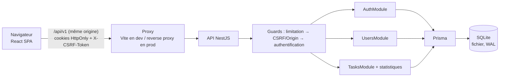

| Couche | Technologies |
|---|---|
| **Backend** (`backend/`) | Node.js ≥ 20.11 (22 LTS recommandé) · NestJS 11 · TypeScript strict · Prisma 6 · SQLite · Argon2id · JWT HS256 · `@nestjs/throttler` · Helmet · Swagger/OpenAPI |
| **Frontend** (`frontend/`) | React 19 · TypeScript · Vite 7 · Tailwind CSS 4 (tokens clair/sombre) · TanStack Query 5 · React Router 7 · dnd-kit · Lucide · polices Sora & DM Sans auto-hébergées |
| **Tests** | Jest + Supertest (unitaires, intégration SQLite réelle, E2E API) · Vitest + Testing Library · Playwright (parcours navigateur contre la vraie API) |

Monolithe modulaire `controller → service → Prisma` ; contrôleurs fins, invariants et autorisations dans les services ; statistiques dans `TasksModule`.

```text
TASKORA/
├── package.json              # npm run setup | start | demo | test
├── scripts/                  # setup.mjs (installation), start.mjs (lancement API + interface)
├── backend/
│   ├── prisma/               # schema.prisma, migrations versionnées, seed.ts
│   ├── scripts/              # backup.ts, restore-check.ts
│   ├── src/
│   │   ├── auth/             # inscription, connexion, refresh rotatif, cookies, CSRF
│   │   ├── users/            # profil, e-mail, mot de passe
│   │   ├── tasks/            # CRUD, liste/Kanban paginés, statistiques
│   │   ├── common/           # guards, filtre d'erreurs, logs, validation, horloge, dates civiles
│   │   └── config/           # validation des variables d'environnement
│   └── test/                 # e2e/ (T01–T24), integration/, helpers/
├── frontend/
│   ├── src/
│   │   ├── lib/              # client API, auth, thème, toasts, requêtes, dates
│   │   ├── components/       # ui/, layout/, tasks/, dashboard/, illustrations/
│   │   └── pages/            # Connexion, Inscription, Tableau de bord, Mes tâches, Profil
│   └── e2e/                  # parcours Playwright + captures
├── docs/screenshots/         # captures de l'interface
├── llm.md · backend.md       # spécifications de référence
└── IMPLEMENTATION_*.md       # plan, statut, traçabilité
```

## 8. Installation manuelle et configuration

`npm run setup` automatise les étapes ci-dessous ; elles sont détaillées ici pour un contrôle fin.

```bash
cd backend && npm ci && cp .env.example .env
```

Générer deux secrets **différents** pour `JWT_ACCESS_SECRET` et `CSRF_SECRET` :

```bash
node -e "console.log(require('crypto').randomBytes(48).toString('base64url'))"
```

```bash
cd backend && mkdir -p prisma/data && npx prisma migrate deploy && npm run build
```

```bash
cd frontend && npm ci && cp .env.example .env.local
```

Lancement séparé (deux terminaux) — ou `npm start` à la racine :

```bash
cd backend && npm run start:prod
```

```bash
cd frontend && npm run dev
```

- Interface : http://localhost:5173 · API : http://localhost:3000/api/v1 · Swagger : http://localhost:3000/api/docs

### Variables d'environnement (`backend/.env`)

La configuration est **validée au démarrage** : l'API refuse de démarrer si un secret manque, fait moins de 32 caractères ou si les deux secrets sont identiques.

| Variable | Défaut | Rôle |
|---|---|---|
| `NODE_ENV` | `development` | `development`, `test` ou `production` |
| `PORT` | `3000` | Port de l'API |
| `DATABASE_URL` | `file:./data/dev.db` | Fichier SQLite (relatif à `backend/prisma/`) |
| `JWT_ACCESS_SECRET` | — | Secret de signature des jetons d'accès (≥ 32 caractères) |
| `CSRF_SECRET` | — | Secret HMAC des jetons CSRF (≥ 32 caractères, différent du précédent) |
| `JWT_ISSUER` / `JWT_AUDIENCE` | `taskora` / `taskora-web` | Claims `iss` / `aud` contrôlés |
| `ACCESS_TOKEN_TTL_SECONDS` | `900` | Durée du jeton d'accès (15 min) |
| `REFRESH_TOKEN_TTL_SECONDS` | `604800` | Durée glissante de session (7 jours) |
| `REFRESH_REUSE_GRACE_SECONDS` | `10` | Fenêtre de tolérance aux refresh simultanés (plusieurs onglets) |
| `FRONTEND_ORIGIN` | `http://localhost:5173` | Origines autorisées (CORS + contrôle `Origin`), séparées par des virgules |
| `COOKIE_SECURE` | `false` (dev) | `true` en HTTPS : cookies `Secure` + préfixe `__Host-` ; **obligatoire en production** |
| `TRUST_PROXY` | `false` | `true` derrière un reverse proxy (IP réelle pour la limitation) |
| `LOG_LEVEL` | `info` | `debug`, `info`, `warn`, `error`, `silent` |
| `SWAGGER_ENABLED` | `true` hors prod | Documentation `/api/docs` |
| `THROTTLE_*` | voir `.env.example` | Seuils de limitation (global, login, inscription, refresh) |

`frontend/.env.local` : `API_PROXY_TARGET` (URL de l'API pour le proxy Vite) et `FRONTEND_PORT`.

## 9. API REST

Base `/api/v1`, JSON. Documentation interactive : **`/api/docs`** (Swagger). Toutes les mutations exigent l'en-tête `X-CSRF-Token` et une origine autorisée.

| Méthode | Route | Auth | Description |
|---|---|---|---|
| GET | `/auth/csrf` | — | Jeton CSRF (à renouveler après connexion/inscription/déconnexion) |
| POST | `/auth/register` | — | `{name, email, password, timeZone?}` → 201, session ouverte |
| POST | `/auth/login` | — | `{email, password}` → 200, cookies de session |
| POST | `/auth/refresh` | cookie refresh | Rotation des cookies |
| POST | `/auth/logout` | session | 204, session révoquée |
| GET | `/auth/me` | ✔ | Profil + session courante |
| GET / PATCH | `/users/me` | ✔ | Profil ; `{name?, email?, currentPassword?, timeZone?}` |
| PATCH | `/users/me/password` | ✔ | `{currentPassword, newPassword}` → 204, autres sessions révoquées |
| POST | `/tasks` | ✔ | Créer (`TODO` / `MEDIUM` par défaut) |
| GET | `/tasks` | ✔ | Liste paginée : `page`, `limit` (≤ 100), `search`, `status`, `priority`, `due` (`all`·`withDate`·`withoutDate`·`overdue`), `sortBy` (`createdAt`·`dueDate`·`priority`·`title`), `sortOrder` |
| GET | `/tasks/stats` | ✔ | `{total, todo, inProgress, done, overdue, completionRate, statusDistribution}` |
| GET / PATCH / DELETE | `/tasks/:id` | ✔ | Lire / modifier partiellement / supprimer définitivement |

**Erreurs normalisées :** `{ "code", "message", "details"?, "requestId" }` avec les codes `VALIDATION_ERROR` (400), `UNAUTHORIZED` (401), `CSRF_INVALID` (403), `NOT_FOUND` (404, y compris la tâche d'un autre utilisateur), `EMAIL_ALREADY_USED` (409), `RATE_LIMITED` (429), `INTERNAL_ERROR` (500, sans trace ni SQL).

Le Kanban n'a pas d'API dédiée : trois appels `GET /tasks?status=…` paginés indépendamment, et les déplacements passent par `PATCH /tasks/:id`.

## 10. Sécurité

- **Mots de passe** : Argon2id (m = 19 Mio, t = 2), 8 à 128 caractères, espaces autorisés.
- **Sessions** : jeton d'accès JWT (15 min) + refresh opaque (7 jours glissants) en **cookies HttpOnly**, jamais exposés au JavaScript. Seule l'empreinte SHA-256 du refresh est stockée. **Rotation** à chaque renouvellement ; la réutilisation d'un ancien jeton révoque la session concernée. Sessions multiples par appareil ; chaque requête vérifie que la session n'est pas révoquée.
- **CSRF** : double vérification sur toutes les mutations — en-tête `Origin`/`Referer` autorisé **et** jeton HMAC lié au cookie CSRF et à la session.
- **Isolation des données** : toutes les requêtes sont filtrées par le propriétaire issu de la session ; une tâche d'autrui renvoie un 404 identique à une tâche inexistante.
- **Validation stricte** : propriétés inconnues refusées (`ownerId`, `completedAt`…), corps JSON limité à 100 Ko, dates civiles réelles (`2026-02-30` refusé), contraintes `CHECK` en base.
- **Limitation** : 120 requêtes/min/IP ; connexion 5/15 min par IP + e-mail ; inscription 3/h/IP ; refresh 30/10 min.
- **Journaux** JSON avec `requestId`, expurgés : aucun mot de passe, jeton, cookie ou jeton CSRF.
- Échéances = **dates civiles** `YYYY-MM-DD` ; le retard est calculé dans le fuseau du compte (fuseau du navigateur capturé à l'inscription).

## 11. Modèle de données

| Table | Champs principaux |
|---|---|
| `User` | `id`, `name`, `email` (unique, normalisé), `passwordHash`, `timeZone`, `createdAt`, `updatedAt` |
| `Session` | `id`, `userId`, `familyId`, `refreshTokenHash` (unique), `expiresAt`, `revokedAt`, `lastUsedAt` |
| `RefreshTokenHistory` | `sessionId`, `tokenHash` (unique), `consumedAt`, `expiresAt` — détection de réutilisation |
| `Task` | `id`, `ownerId`, `title`, `description?`, `status`, `priority`, `dueDate?` (texte `YYYY-MM-DD`), `completedAt?`, `priorityRank`, `searchText`, `titleSort`, `createdAt`, `updatedAt` |

`priorityRank`, `searchText` (sans casse ni accents) et `titleSort` permettent un tri et une recherche corrects en SQLite. `completedAt` est renseigné au passage à *Terminée* et vidé à la réouverture. Migrations versionnées dans `backend/prisma/migrations/`.

## 12. Tests et qualité

| Suite | Commande | Contenu |
|---|---|---|
| Backend unitaires + intégration | `npm --prefix backend test` | Dates/fuseaux, configuration, journaux, contraintes SQL, seed, sauvegarde/restauration |
| Backend E2E API | `npm --prefix backend run test:e2e` | Matrice T01–T24 : sessions, rotation/réutilisation, CSRF, limitation, isolation, filtres, Kanban, statistiques, journaux |
| Frontend unitaires | `npm --prefix frontend test` | Client API (CSRF, refresh unique, erreurs), formulaires, badges, dialogue |
| Parcours navigateur | `npm --prefix frontend run test:e2e` | Playwright desktop + mobile contre la vraie API (ports 3200/5273, base `e2e.db` recréée) |
| Tout le back + front unitaire | `npm test` (racine) | — |
| Qualité statique | `npm run lint` et `npm run typecheck` dans chaque dossier | ESLint + TypeScript strict |

Dernière exécution : **30 + 51** tests backend, **13** tests frontend et **18** parcours Playwright, tous réussis. Détails dans [`IMPLEMENTATION_STATUS.md`](IMPLEMENTATION_STATUS.md).

Régénérer les captures de ce README :

```bash
cd frontend && CAPTURE=1 npx playwright test e2e/screenshots.spec.ts --project=desktop
```

Playwright utilise Chromium ; s'il n'est pas installé : `npx playwright install chromium`.

## 13. Exploitation : scripts, sauvegarde, mise en production

### Scripts backend (`cd backend`)

| Script | Rôle |
|---|---|
| `npm run dev` / `npm run start:prod` | API en mode développement / compilée |
| `npm run db:migrate` | Créer une nouvelle migration (développement) |
| `npm run db:deploy` | Appliquer les migrations versionnées (livraison) |
| `npm run db:seed` | Données fictives, uniquement sur demande ; refusé en production sans `SEED_ALLOW_PRODUCTION=true` |
| `npm run db:backup [-- fichier]` | Instantané cohérent à chaud (`VACUUM INTO`) + `PRAGMA integrity_check` |
| `npm run db:restore-check -- fichier` | Teste une sauvegarde sur une copie séparée (intégrité, migrations, inventaire) |

### Restaurer une sauvegarde

1. Vérifier la sauvegarde : `npm run db:restore-check -- backups/<fichier>.db`.
2. Arrêter TASKORA.
3. Copier la sauvegarde à l'emplacement de la base (`backend/prisma/data/dev.db` par défaut) et supprimer les éventuels fichiers `dev.db-wal` / `dev.db-shm`.
4. `npm run db:deploy` (n'applique que les migrations manquantes), puis relancer.

### Mise en production (guide)

1. `npm run build` dans `backend/` et `frontend/`.
2. Servir `frontend/dist` et proxifier `/api` vers l'API derrière un reverse proxy **HTTPS**, sur le même site.
3. `NODE_ENV=production`, `COOKIE_SECURE=true`, `FRONTEND_ORIGIN=https://votre-domaine`, `TRUST_PROXY=true`, secrets générés hors Git (Swagger désactivé par défaut en production).
4. `npm run db:deploy` avant chaque démarrage d'une nouvelle version ; base sur un volume persistant ; sauvegardes régulières hors de la machine.
5. **Une seule instance** de l'API (SQLite et limitation en mémoire ne se partagent pas entre plusieurs serveurs).

## 14. Documents du projet

| Document | Contenu |
|---|---|
| [`llm.md`](llm.md) | Spécification frontend (écrans, design, interactions) |
| [`backend.md`](backend.md) | Spécification backend (API, sécurité, données) |
| [`IMPLEMENTATION_PLAN.md`](IMPLEMENTATION_PLAN.md) | Plan et arbitrages |
| [`IMPLEMENTATION_STATUS.md`](IMPLEMENTATION_STATUS.md) | État réel, résultats de tests, limites connues |
| [`IMPLEMENTATION_TRACEABILITY.md`](IMPLEMENTATION_TRACEABILITY.md) | Correspondance exigence → code → test |

**Hors périmètre V1 (volontairement) :** récupération de mot de passe, équipes et partage, projets/catégories, sous-tâches, rappels et notifications, pièces jointes, connexion via Google/Facebook.
