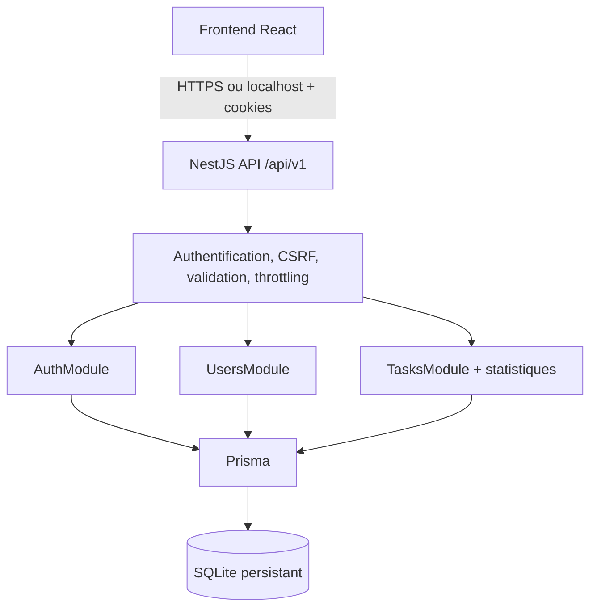
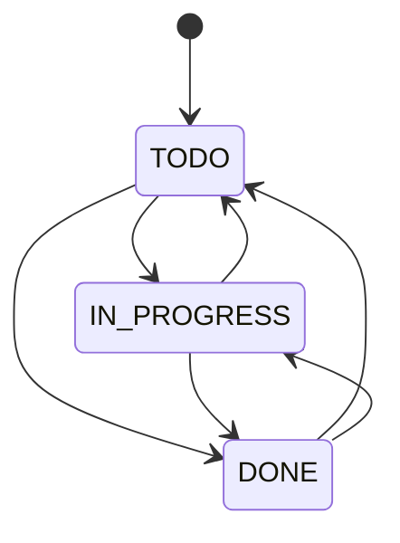

# TASKORA — BACKEND.MD
## Spécification technique backend — NestJS · TypeScript · Prisma · SQLite

**Version :** 1.0 — décisions backend B01–B06 validées le 1er novembre 2026  
**Statut :** référence d'architecture et d'implémentation, pas un code source  
**Périmètre :** backend exclusivement ; ne décrit pas le design ni les composants React  
**Référence produit :** `llm.md`, cadrage frontend D01–D08. En cas d'écart, distinguer les décisions produit validées des conventions techniques proposées ci-dessous.

> **Mandat pour Claude Code / Codex :** implémenter exactement le périmètre décrit, de façon testable, sans fonctionnalités supplémentaires. Ne pas générer de faux endpoints, ni retourner des données de démonstration en production. Les éléments signalés « convention technique » peuvent être adaptés seulement avec justification et sans casser les contrats. Les exigences marquées « validé » sont obligatoires.

---

# A. Fondamentaux et frontières

## A1. Mission
TASKORA est une application **personnelle** de gestion des tâches. Le serveur assure comptes et sessions, isolation des données, tâches et transitions de statut, recherche/filtres/tri paginés et statistiques calculées côté backend. Le frontend React consomme l'API JSON. Le périmètre doit rester réaliste pour un projet de formation : aucun microservice ni service externe requis.

## A2. Capacités en V1 — validé
- Inscription (nom, email unique, mot de passe), connexion, session persistante et déconnexion avec révocation serveur.
- Plusieurs sessions simultanées par utilisateur ; jeton d'accès JWT court (15 min), refresh token renouvelable (7 jours), rotation, hashage et détection de réutilisation.
- Consultation et modification du profil (nom, email, mot de passe) ; mot de passe actuel requis pour changer email ou mot de passe.
- CRUD de tâches privées ; statuts **À faire / En cours / Terminée** ; priorités **Basse / Moyenne / Haute** ; échéance calendaire facultative.
- Recherche, filtres, tri, pagination serveur pour liste ; pagination indépendante des trois colonnes du Kanban.
- Statistiques globales par propriétaire : total, répartition par statut, progression, retard et tâches prioritaires/échéances utiles à l'interface.
- Documentation OpenAPI ; migrations versionnées ; seed optionnel explicite ; tests ciblés ; sauvegarde/restauration SQLite.

## A3. Exclusions fermes
Aucun rôle admin, équipe, projet, catégorie personnalisée, partage, transfert de tâches, sous-tâche, commentaire, pièce jointe, import/export, notification, email de vérification, récupération de compte, OAuth, MFA, abonnement, paiement, IA, realtime, file de messages ou service tiers. Ne pas ajouter d'API correspondante.

## A4. Stack et principes — validé
- **Node.js version LTS supportée par la version choisie de NestJS**, TypeScript strict, NestJS et Prisma ORM.
- **SQLite** en fichier persistant ; une seule instance d'application écrit dans cette base lors de la V1.
- Monolithe modulaire, structure en couches **controller → service → Prisma** ; séparation claire des DTO, de la sécurité et de l'accès aux données.
- API REST JSON, préfixe **`/api/v1`** ; réponses de succès conventionnelles (objet/tableau direct) ; erreurs uniformisées.
- Développement et livraison locale en priorité ; Docker facultatif ; guide de déploiement distant sans obligation d'hébergement.
- Aucun jeton ni mot de passe brut dans les journaux ou en base. Les décisions précises de bibliothèques non imposées sont des conventions, pas des règles métier.

## A5. Registre des décisions
| ID | Sujet | Décision validée |
|---|---|---|
| B01 | Identité | Cookies HttpOnly, access et refresh, sessions multiples, 8 caractères min, activation immédiate, révocation |
| B02 | Métier | titre 1–150, description ≤ 2 000, valeurs par défaut, retard calculé, `completedAt`, suppression définitive, propriété exclusive |
| B03 | Architecture | NestJS modulaire, `/api/v1`, statistiques dans TasksModule, pagination/filtres/tri serveur, JSON direct, Swagger |
| B04 | Sécurité | DTO stricts, 404 indistinct, throttling global/renforcé, CSRF jeton + Origin, erreurs/logs structurés |
| B05 | Livraison | local d'abord, Docker facultatif, migrations versionnées, seed séparé, tests unit/intégration/E2E, backup cohérent |
| B06 | Arbitrages | access 15 min, refresh 7 j rotation/réutilisation, échéances calendaires par fuseau utilisateur, Kanban paginé par colonne, mot de passe actuel pour email/password |

---

# B. Architecture fonctionnelle

## B1. Modules NestJS
| Module | Responsabilité | Dépendances applicatives |
|---|---|---|
| `AuthModule` | inscription, connexion, refresh, déconnexion, cookies, émission/révocation tokens, sessions | Users + Prisma + Crypto + Config |
| `UsersModule` | lecture et modification du profil authentifié, changement sensible avec réauthentification | Prisma + service de hashage |
| `TasksModule` | CRUD, propriété, filtres/pagination, Kanban par statut, statistiques | Prisma + horloge/fuseau |
| `PrismaModule` | client Prisma injectable, connexion, transactions, cycle de vie | configuration |
| `Common` (transversal) | guards auth, filtre d'exception, validation globale, requestId, journalisation, throttling, CSRF | aucune règle métier |
| `ConfigModule` | validation des variables d'environnement au démarrage | environnement |

**Conventions de dépendances :** contrôleurs fins, validations à la frontière via DTO ; services détiennent invariants et autorisations ; Prisma accessible depuis services uniquement ; pas d'appels HTTP entre modules. Les statistiques **restent** dans `TasksModule` ; ne pas créer de `StatisticsModule`.

## B2. Vue des interactions


## B3. Principes métier transversaux
1. Toutes les données des tâches sont filtrées par `ownerId` venant de la **session vérifiée** ; jamais accepter un `ownerId` dans les DTO publics.
2. Les statuts sont exactement `TODO`, `IN_PROGRESS`, `DONE` et les priorités `LOW`, `MEDIUM`, `HIGH` dans les échanges API (**convention technique**). Le frontend affiche leurs libellés français.
3. Toute mutation valide et persiste atomiquement les champs modifiés ; seules les propriétés explicitement présentes dans un PATCH sont changées.
4. Le frontend confirme visuellement la suppression, mais **l'autorisation et la suppression effective relèvent du serveur**.
5. Aucun résultat de statistiques ne doit être calculé à partir d'une seule page de tâches.
6. Les requêtes concurrentes doivent respecter l'authentification et la propriété, même si les ID sont devinés.

---

# C. Modélisation de données

## C1. Entités canoniques

### User
| Champ | Type logique | Règles |
|---|---|---|
| `id` | UUID/chaîne | PK, généré serveur |
| `name` | string | requis, trim, 1–100 caractères (**convention technique**) |
| `email` | string | requis, normalisé trim + minuscule, unique ; validation email |
| `passwordHash` | string | requis, Argon2id recommandé, jamais exposé |
| `timeZone` | string | fuseau IANA, initialisé par défaut `Africa/Porto-Novo` **seulement comme convention locale**, non supposé universel ; modifiable par mécanisme décrit en C4 |
| `createdAt` / `updatedAt` | DateTime | instants UTC |

**Important :** l'utilisateur n'a pas validé de paramètre « fuseau horaire » dans l'interface Profil. Pour éviter d'ajouter un contrôle UI non prévu, convention recommandée : déduire initialement le fuseau navigateur via `Intl.DateTimeFormat().resolvedOptions().timeZone` lors de l'inscription, le transmettre explicitement, et le conserver sur le compte ; fallback serveur UTC si absent ou invalide. Un changement ultérieur de fuseau nécessite un contrat technique explicite (voir C4) et ne doit pas inventer un nouvel écran. Le fuseau `Africa/Porto-Novo` est seulement un exemple de test, **pas** un défaut universel.

### Session
| Champ | Type logique | Règles |
|---|---|---|
| `id` | UUID | PK, identifiant de session |
| `userId` | FK User | cascade delete si compte supprimé à l'avenir ; aucune API suppression compte V1 |
| `refreshTokenHash` | string | empreinte du token renouvelable courant, unique si pertinent |
| `familyId` | UUID | identifie la famille de rotation d'une session |
| `createdAt`, `expiresAt` | DateTime | UTC ; expiration glissante 7 jours par refresh **convention**, à limiter explicitement si durée absolue introduite |
| `revokedAt` | DateTime? | null si valide |
| `lastUsedAt` | DateTime? | UTC |

**Détection de réutilisation :** conserver les identifiants (`jti`) des refresh tokens consommés jusqu'à leur expiration, sous forme de hash/identifiant non secret ; une table `RefreshTokenHistory` ou un modèle de rotation équivalent est **nécessaire** pour détecter la réutilisation d'un ancien token après rotation. Sa structure exacte est une convention technique ; ne jamais stocker d'anciens tokens bruts. En cas de token déjà consommé : invalider la famille de session concernée, journaliser sans token et renvoyer 401. Prévoir une courte stratégie de concurrence pour les refresh simultanés (single-flight côté client conseillé, transaction atomique côté serveur). Ne pas révoquer toutes les autres sessions du compte par défaut.

### Task
| Champ | Type logique | Règles |
|---|---|---|
| `id` | UUID | PK, généré serveur |
| `ownerId` | FK User | obligatoire, indexé ; immutable |
| `title` | string | trim, 1–150 caractères non blancs |
| `description` | string? | facultatif, ≤ 2 000 caractères, peut être null |
| `status` | enum/string | `TODO` par défaut |
| `priority` | enum/string | `MEDIUM` par défaut |
| `dueDate` | `YYYY-MM-DD`/DATE logique ? | optionnelle, **date calendaire sans heure** |
| `completedAt` | DateTime? | UTC, défini lors du passage à DONE et vidé quand on en sort |
| `createdAt`, `updatedAt` | DateTime | UTC, gérés serveur |

**SQLite/Prisma et date seule :** ne pas sérialiser une date calendaire en timestamp UTC affichable comme minuit local. En V1, **convention technique recommandée :** persister `dueDate` sous forme de chaîne ISO `YYYY-MM-DD` validée strictement (y compris calendrier réel), pour garantir l'absence de décalage jour/fuseau. Les timestamps restent en DateTime UTC.

## C2. Contraintes et index
- `User.email` unique, normalisé avant écriture ; gérer collision en 409 sans fuite d'informations sensibles.
- `Task.ownerId` FK index ; index composés suggérés `(ownerId, status, createdAt)` et `(ownerId, dueDate)` ; vérifier les plans de requêtes avant surindexation.
- `Session.userId`, `Session.familyId`, `Session.expiresAt` indexés selon requêtes.
- Suppression de tâche **physique**, non soft delete, après vérification propriété.
- Aucune historisation détaillée des changements V1 : les tâches terminées restent consultables grâce au statut ; `completedAt` représente l'**état courant**, pas un journal des réouvertures.
- Migrations Prisma versionnées et commitées ; jamais de `db push` substitué au processus normal de migration livré.

## C3. Invariants et transitions

Toutes les transitions entre les trois statuts sont autorisées (**convention technique**, puisque le produit ne restreint pas les transitions). Sur `status` passant de non-DONE vers DONE : `completedAt = now()` ; sur sortie de DONE : `completedAt = null` ; sur autre modification d'une tâche DONE : conserver `completedAt`. Pour une création directement en DONE si le DTO autorise le statut : renseigner `completedAt` au moment de création.

## C4. Échéances et retards — règle importante
- `dueDate` est une date civile inclusive, au format ISO `YYYY-MM-DD`, sans heure.
- Une tâche **n'est en retard** que si `status != DONE`, `dueDate != null` et `dueDate < today(timeZone de l'utilisateur)`.
- `today(timeZone)` doit être calculé à chaque requête de statistiques ou de liste pertinente avec une horloge injectable ; **ne pas** persister un booléen `isOverdue`.
- La préférence de fuseau est conservée avec l'utilisateur : fournir initialement son fuseau lors de l'inscription (facultatif ; validation IANA). Pour gérer le changement de fuseau sans nouvelle page Profil, le frontend peut transmettre le fuseau courant dans un en-tête technique vérifié **sur les requêtes de lecture** uniquement ; ceci doit être stabilisé dans le contrat API. **Convention recommandée pour V1 :** utiliser le fuseau sauvegardé au compte ; pas de modification automatique sur simple navigation. Si l'utilisateur change réellement de fuseau, un champ `timeZone` facultatif dans `PATCH /users/me` suffit sans nouvel écran obligatoire.
- Ne pas mélanger comparaison ISO de dates civiles et instants UTC ; les horodatages serveur restent UTC.
- Test obligatoire aux frontières de jour, mois, année et changements d'heure d'été dans les fuseaux concernés.

## C5. Transactions et concurrence
- Les opérations sur sessions/refresh (consommation de l'ancien et création du nouveau) doivent être atomiques ; vérifier la capacité transactionnelle de SQLite et utiliser des mises à jour conditionnelles quand nécessaire.
- Les mises à jour de tâche sont atomiques, filtrées par `id` **et** `ownerId`. Sur une concurrence de modifications, dernière écriture validée gagne (**convention pour V1**, aucun verrou collaboratif).
- La création et la modification d'email doivent gérer proprement les collisions d'unicité.
- Aucun `ownerId`, `createdAt`, `updatedAt`, `completedAt`, `passwordHash` n'est modifiable directement depuis un DTO public.

---

# D. Contrats API v1

## D1. Conventions HTTP
- Base : `/api/v1` ; `Content-Type: application/json`, UTF-8.
- JSON de succès : ressource ou collection directement, sans enveloppe `success/data` ; les collections paginées possèdent un objet de pagination explicite.
- Authentification par **cookies HttpOnly** ; le navigateur envoie `credentials: include` lorsque nécessaire. Ne pas transmettre les tokens dans les corps JSON.
- Toutes les routes authentifiées vérifient JWT, session non révoquée si exigé par la stratégie et appartenance des ressources.
- CSRF : voir section E ; endpoints mutatifs et refresh/logout protégés selon politique explicite.
- Paramètres non connus rejetés dans les DTO et paramètres de requête validés ; réponses d'erreur standardisées.
- Préfixe et contrats réels documentés dans Swagger/OpenAPI ; éviter les exemples contradictoires.

## D2. Endpoints d'authentification
| Méthode | Route | Auth | Requête | Succès |
|---|---|---|---|---|
| POST | `/auth/register` | non | `{name,email,password,timeZone?}` | 201, profil public, cookies de session **convention** |
| POST | `/auth/login` | non | `{email,password}` | 200, profil public, cookies sécurisés |
| POST | `/auth/refresh` | cookie refresh | corps vide | 200, cookies renouvelés ; identité publique minimale optionnelle |
| POST | `/auth/logout` | session existante | corps vide | 204, cookies effacés, session révoquée |
| GET | `/auth/me` | access | — | 200, profil public, état de session |
| GET | `/auth/csrf` | non ou session | — | 200, mise à disposition du jeton CSRF selon mécanisme retenu |

**Convention de parcours :** après inscription valide, ouvrir une session immédiatement afin de ne pas demander de connexion supplémentaire ; sans vérification email. `register` peut être adapté si le frontend attend redirection manuelle, à documenter avec un seul comportement final. L'absence d'envoi email ne signifie pas que l'adresse est vérifiée.

**Cookie policy — convention de référence :** `__Host-taskora_access` et `__Host-taskora_refresh` quand l'environnement est HTTPS avec `Secure`, `HttpOnly`, `Path=/`, absence d'attribut Domain ; SameSite=Lax lorsque frontend/API sont same-site. Pour séparer les portées par Path, utiliser des noms sans préfixe `__Host-` et documenter les restrictions. Sur localhost HTTP de développement, prévoir uniquement des adaptations d'environnement explicites ; ne jamais affaiblir les cookies de production. Un cookie `__Host-` impose `Secure` et `Path=/` ; ne pas mélanger des contraintes incompatibles.

## D3. Endpoints profil
| Méthode | Route | Auth | Corps | Succès |
|---|---|---|---|---|
| GET | `/users/me` | oui | — | 200, UserPublic |
| PATCH | `/users/me` | oui | `{name?,email?,currentPassword?,timeZone?}` | 200, UserPublic |
| PATCH | `/users/me/password` | oui | `{currentPassword,newPassword}` | 204, changement effectué |

`currentPassword` est exigé **lorsqu'un changement d'email est demandé** ; la modification du seul nom/fuseau n'en a pas besoin. `currentPassword` est toujours exigé pour `/users/me/password`. Refuser un email déjà utilisé avec 409. Politique de session après changement de mot de passe : **convention sécurité** : révoquer les autres sessions ; maintenir ou renouveler la session courante après réauthentification, à consigner. Aucun écran de « mot de passe oublié » ni endpoint de réinitialisation V1.

## D4. Tâches — contrat de base
| Méthode | Route | Auth | Objectif | Succès |
|---|---|---|---|---|
| POST | `/tasks` | oui | créer sa tâche | 201, Task |
| GET | `/tasks` | oui | lister/rechercher/filtrer/trier | 200, TaskPage |
| GET | `/tasks/stats` | oui | statistiques globales, hors filtres de Liste | 200, Stats |
| GET | `/tasks/:id` | oui | lire sa tâche | 200, Task |
| PATCH | `/tasks/:id` | oui | modifier ou changer statut | 200, Task |
| DELETE | `/tasks/:id` | oui | supprimer définitivement | 204 |

**Ordre de routes NestJS :** déclarer `/tasks/stats` avant `/tasks/:id` pour éviter l'ambiguïté.

### Task — JSON public (exemple de structure)
```json
{
  "id": "uuid",
  "title": "Préparer le brief",
  "description": "Valider les écrans",
  "status": "IN_PROGRESS",
  "priority": "HIGH",
  "dueDate": "2026-11-12",
  "isOverdue": false,
  "completedAt": null,
  "createdAt": "2026-11-01T12:00:00.000Z",
  "updatedAt": "2026-11-01T12:00:00.000Z"
}
```
`isOverdue` est un **champ calculé en lecture**, jamais en entrée ; sa valeur dépend du fuseau choisi pour la requête. `description`, `dueDate`, `completedAt` peuvent être null. Les champs sensibles/ownerId ne sont pas nécessaires dans le JSON public.

### POST /tasks
```json
{"title":"Préparer le brief","description":"Valider les écrans","priority":"HIGH","status":"TODO","dueDate":"2026-11-12"}
```
- `title` obligatoire, trim, longueur 1–150 ; description nullable ≤ 2000.
- `status` facultatif, défaut TODO ; `priority` facultative, défaut MEDIUM.
- `dueDate` facultative, valide ISO calendrier ; `null` signifie pas d'échéance.
- Rejeter `ownerId`, `completedAt`, dates système et toute propriété inconnue.

### PATCH /tasks/:id
- Corps partiel des champs `title`, `description`, `priority`, `status`, `dueDate` ; corps vide refusé (**convention**).
- `description: null` supprime la description ; `dueDate: null` retire l'échéance.
- Le passage à DONE renseigne `completedAt` atomiquement ; la réouverture le vide.
- PUT non requis. Les mutations de Kanban utilisent ce même PATCH ; **pas** d'endpoint parallèle pour les déplacements.

## D5. Recherche, filtres et pagination
`GET /tasks?page=1&limit=20&search=brief&status=TODO&priority=HIGH&due=overdue&sortBy=createdAt&sortOrder=desc`

| Query | Valeurs — convention technique |
|---|---|
| `page` | entier ≥1, défaut 1 |
| `limit` | entier 1–100, défaut 20 |
| `search` | chaîne trim, max 100, recherche insensible à la casse sur titre ; description optionnelle si testée |
| `status` | `TODO`, `IN_PROGRESS`, `DONE` |
| `priority` | `LOW`, `MEDIUM`, `HIGH` |
| `due` | `all`, `withDate`, `withoutDate`, `overdue` |
| `sortBy` | `createdAt`, `dueDate`, `priority`, `title` |
| `sortOrder` | `asc` ou `desc` |

Comportement : conditions combinées par **ET**, toujours `ownerId = utilisateur`. Ordre stable avec `id` comme dernier critère de tri. `priority` utilise ordre sémantique LOW < MEDIUM < HIGH ; échéances nulles classées à la fin (**convention**) ; documenter le traitement effectif SQLite. Pour `due=overdue`, utiliser la date du jour au fuseau utilisateur et exclure DONE.

### TaskPage
```json
{
  "items": [],
  "pagination": {"page":1,"limit":20,"total":0,"totalPages":0,"hasNextPage":false}
}
```

## D6. Pagination Kanban — sans nouvel endpoint obligatoire
Les trois colonnes utilisent **trois requêtes distinctes** de `GET /tasks` : `status=TODO`, `status=IN_PROGRESS`, `status=DONE`, chacune avec ses propres `page`/`limit` et total. Le serveur ne doit jamais appliquer une pagination globale commune aux trois colonnes. Les filtres/recherche éventuellement partagés sont répétés sur les trois appels. Après déplacement, rafraîchir source, destination et statistiques. Aucun ordre manuel persistant des cartes n'a été validé : **ne pas** créer `position` ni une API de réordonnancement intrastatut.

## D7. Statistiques du tableau de bord
`GET /tasks/stats` retourne un objet cohérent avec le frontend :
```json
{
  "total": 0,
  "todo": 0,
  "inProgress": 0,
  "done": 0,
  "overdue": 0,
  "completionRate": 0,
  "statusDistribution": {"TODO":0,"IN_PROGRESS":0,"DONE":0}
}
```
Calcul : `completionRate = total > 0 ? round(done / total * 100, 1) : 0`. `overdue` respecte C4. Les trois compteurs de statuts doivent totaliser `total`. **Les cartes « tâches prioritaires » et « en retard » du dashboard proviennent de `GET /tasks` filtré/trié** et non d'un deuxième système de statistiques. Les statistiques sont globales au propriétaire et indépendantes de la pagination Liste.

## D8. Contrat d'erreur normalisé
```json
{
  "code":"VALIDATION_ERROR",
  "message":"Données invalides",
  "details":{"title":["Le titre est obligatoire"]},
  "requestId":"req_01"
}
```
Codes à distinguer : `VALIDATION_ERROR` (400), `UNAUTHORIZED` (401), `CSRF_INVALID` (403), `NOT_FOUND` (404, notamment ressource d'autrui), `EMAIL_ALREADY_USED` (409), `RATE_LIMITED` (429), `INTERNAL_ERROR` (500). Pour login, utiliser un message uniforme identifiants invalides et ne pas divulguer l'existence d'un email. Les 500 ne révèlent ni stack trace ni SQL.

## D9. Table des cas critiques
| Situation | Résultat attendu |
|---|---|
| Inscription email existant | 409 sans divulguer de données du compte |
| Connexion identifiants invalides | 401 message générique |
| Token expiré | 401 ; refresh possible si valide |
| Refresh expiré/révoqué/réutilisé | 401 ; cookies invalidés selon politique |
| CSRF manquant ou invalide | 403 avant mutation |
| Tâche absente ou appartenant à autrui | 404 identique |
| Titre vide/espaces | 400 avec détails |
| Date `2026-02-30` | 400 |
| Champ interdit (`ownerId`) | 400 DTO strict |
| Suppression valide | 204, tâche non récupérable |
| Email/mot de passe changé sans ancien mot de passe | 400 ou 401 selon erreur de validation, sans modification |

---

# E. Sécurité applicative

## E1. Secrets et hashage
- Mots de passe : Argon2id (recommandation), paramètres adaptés à l'environnement, jamais réversibles ni logués ; supporter ≥8 caractères, mots de passe longs et espaces valides.
- Refresh tokens : secrets générés avec CSPRNG et empreintes non réversibles stockées ; l'exemple exact dépend de la librairie retenue. Access JWT signé par clé secrète forte, rotation de secret documentée, `iss`, `aud`, `sub`, `sid`, `exp`, `jti` contrôlés. Ne jamais accepter `alg=none`.
- Secrets dans `.env` non commité ; `.env.example` sans valeurs secrètes ; validation de configuration au démarrage.

## E2. Cookies et CSRF — validé
- Access + refresh en cookies **HttpOnly**, `Secure` en environnement HTTPS, `SameSite` défini selon topologie. `credentials` explicite côté navigateur.
- **Jeton CSRF dédié + vérification de l'en-tête `Origin`** sur toutes les mutations fondées sur les cookies, y compris login/register/refresh/logout selon implémentation ; le jeton CSRF est lisible/transmissible par le frontend dans un en-tête personnalisé, **distinct** des cookies d'authentification HttpOnly.
- Recommandation : synchronizer token lié à session ou double-submit **signé** et lié cryptographiquement à la session ; ne pas considérer un cookie CSRF non signé comme protection suffisante. Décrire bootstrap pré-auth via `GET /auth/csrf` et renouvellement après login/refresh si nécessaire.
- CORS explicite sur origines autorisées, `credentials: true`, jamais `*` avec credentials. Si frontend et API sont cross-site, `SameSite=None; Secure` requis et vérifier une politique de CSRF robuste ; documenter la topologie choisie.
- Ne pas exiger HTTPS sur le localhost HTTP par simple supposition : mettre une configuration de dev documentée et une politique de prod stricte.

## E3. Autorisations
- Le Guard exige une session valide ; service `Tasks` utilise `where: {id, ownerId: auth.userId}` ou équivalent atomique sur chaque opération.
- Les listes, statistiques et suggestions prioritaires sont filtrées par le même propriétaire.
- Différencier 401 (non authentifié) et 404 (ressource invisible/non existante) ; jamais 403 révélant que l'ID privé appartient à un autre.
- Ne pas faire confiance aux claims venant du frontend ni à un `userId` en query/body.

## E4. DTO et protection contre abus
- `ValidationPipe` global, transformation contrôlée, `whitelist` et `forbidNonWhitelisted`, DTO complets, validation imbriquée si besoin.
- Limite raisonnable de taille JSON ; protection brute-force connexion/inscription/refresh et limite globale par IP/principal. **Seuils proposés** : global 120 req/min/IP ; login 5/15 min par IP + email normalisé, register 3/h/IP, refresh 30/10 min/session/IP ; adapter et tester pour utilisateurs derrière NAT. Ces seuils sont des **conventions d'exploitation, non des décisions validées**.
- Pas de HTML rendu par le backend ; les textes de tâches sont des chaînes non fiables ; le frontend doit les échapper.
- Headers de sécurité adaptés, erreurs sans stack traces, dependencies maintenues.

## E5. Journalisation
- `requestId` créé/propagé de manière sûre, durée, chemin, méthode, statut, catégorie d'erreur ; opérations sensibles consignées de façon minimisée.
- Ne jamais loguer `password`, `currentPassword`, JWT, refresh, CSRF, `Cookie`, `Set-Cookie`, en-têtes Authorization ni corps contenant secrets.
- Journaliser un token refresh réutilisé uniquement comme événement et identifiants non secrets ; pas son contenu.

## E6. Analyse de menaces minimale
| Menace | Prévention | Détection/réaction |
|---|---|---|
| Accès à la tâche d'autrui | filtre propriétaire systématique | tests IDOR + 404 uniforme |
| Vol de refresh token | cookie sécurisé, rotation, hash | réutilisation → révocation famille |
| CSRF | jeton dédié + vérification Origin | 403 + log expurgé |
| Brute force | limites ciblées, hashage robuste | 429 et métriques |
| Injection/overposting | DTO strict + Prisma paramétré | 400 et tests champs interdits |
| Fuite de secrets via logs | redaction, config stricte | audit logs et test non-divulgation |
| Perte fichier SQLite | backup cohérent | restauration périodiquement testée |

---

# F. Exploitation, migrations et déploiement

## F1. Environnements
- **Local prioritaire** : Node LTS, npm/pnpm fixé par lockfile, NestJS port configurable (`3000` conseillé), React `5173` à titre indicatif ; SQLite dans un dossier durable non commité.
- **Test** : DB SQLite temporaire isolée par suite, migrations appliquées avant tests ; suppression après tests.
- **Production documentée** : un processus applicatif écrivant en SQLite sur volume persistant, TLS en reverse proxy et cookies stricts ; pas de scaling horizontal multi-instance sur un seul fichier SQLite.

## F2. Variables d'environnement minimales
```dotenv
NODE_ENV=development
PORT=3000
DATABASE_URL=file:./dev.db
JWT_ACCESS_SECRET=REPLACE_ME
JWT_ISSUER=taskora
JWT_AUDIENCE=taskora-web
ACCESS_TOKEN_TTL_SECONDS=900
REFRESH_TOKEN_TTL_SECONDS=604800
FRONTEND_ORIGIN=http://localhost:5173
COOKIE_SECURE=false
LOG_LEVEL=info
```
**Exemple seulement :** ne jamais mettre `REPLACE_ME` en service. La gestion des secrets de refresh, CSRF et hachage est explicitée par l'implémentation choisie ; ajouter les variables nécessaires et les valider. Les secrets sont générés aléatoirement et stockés hors Git. Le chemin SQLite est résolu explicitement selon la version Prisma choisie.

## F3. Migrations
- En développement : créer une migration Prisma versionnée pour chaque changement de schéma, inspecter le SQL SQLite, commiter `schema.prisma`, migrations et lockfile.
- En livraison : exécuter `prisma migrate deploy` via une étape explicite avant lancement ; **pas de migration implicite** dans chaque requête ou démarrage aveugle.
- Backups avant migration destructrice. Ne jamais supprimer l'historique de migrations pour masquer un échec.
- Vérifier la compatibilité de la version installée de Prisma avec SQLite et les enums : si l'ORM ne prend pas en charge un enum natif SQLite, utiliser des chaînes validées par DTO/service et, au besoin, des contraintes SQL compatibles.

## F4. Seed pédagogique
- Script **séparé**, exécuté uniquement sur commande explicite et seulement sur un environnement prévu ; jeu de données fictives pour un utilisateur d'exemple et ses tâches.
- Empêcher exécution automatique en production ; refuser sans opt-in explicite si `NODE_ENV=production`.
- Ne jamais utiliser de vrais identifiants ou données sensibles dans les fixtures.

## F5. SQLite : sauvegarde, restauration, limites
- SQLite en WAL si adapté et testé ; activer `foreign_keys` et configurer les délais de contention raisonnables.
- Sauvegarde cohérente via API SQLite de backup, commande `.backup` ou `VACUUM INTO` selon compatibilité ; ne pas copier naïvement un fichier actif avec WAL.
- Procédure : identifier DB cible, préparer emplacement, créer snapshot, contrôler intégrité (`PRAGMA integrity_check`), conserver permissions, tester restauration sur base séparée et relancer les migrations uniquement si nécessaires.
- Documenter rétention et stockage hors hôte si passage en production ; pour une formation locale, une procédure manuelle testable suffit.
- **Limite assumée :** SQLite ne convient pas à plusieurs réplicas écrivant indépendamment. Une évolution vers PostgreSQL serait un projet ultérieur, non la V1.

## F6. Scripts de livraison attendus
- `dev`, `build`, `start`, `start:prod`, `lint`, `typecheck`, `test`, `test:e2e`, `prisma:generate`, `db:migrate`, `db:deploy`, `db:seed`, `db:backup`, `db:restore-check` ou équivalents documentés.
- README avec prérequis, installation, génération de secrets, copie `.env.example`, migration, lancement, Swagger, tests, seed facultatif, backup/restore et dépannage.
- Swagger accessible localement sur route documentée (ex. `/api/docs`) ; en production désactiver ou protéger selon contexte.
- Docker facultatif, n'est pas une condition du fonctionnement local.

---

# G. Qualité, tests et critères d'acceptation

## G1. Pyramide de tests
**Unitaires** : validation de titre/description/date, statut/completedAt, calcul isOverdue par timezone, progression, normalisation email, filtre propriétaire, logique rotation de tokens.  
**Intégration** : vraie base SQLite de test migrée, contraintes uniques/FK, pagination/filtres/tri, mises à jour conditionnelles, transactions refresh et suppression.  
**E2E API** : serveur NestJS démarré, cookies/CSRF, inscription→connexion→refresh→profil→CRUD→stats→logout ; cas négatifs, race refresh et isolation multi-utilisateur.

## G2. Matrice de tests minimaux
| ID | Scénario | Attendu |
|---|---|---|
| T01 | Créer compte puis utiliser `/auth/me` | session valide et profil sans hash |
| T02 | Même email deux fois | 409, unicité préservée |
| T03 | Mot de passe 7 caractères | 400 |
| T04 | Connexion erronée et répétée | 401 puis 429 selon seuil |
| T05 | Access expiré, refresh valide | nouveaux cookies, ancien refresh consommé |
| T06 | Réutiliser ancien refresh | 401, révocation famille correspondante |
| T07 | Déconnexion | session révoquée, cookies effacés, refresh refusé |
| T08 | Deux sessions appareils | déconnexion de A ne coupe pas B |
| T09 | CSRF absent ou Origin interdit | 403, aucune mutation |
| T10 | Utilisateur B tente lire/éditer/supprimer tâche A | 404, aucune fuite |
| T11 | Créer tâche sans priorité/statut | MEDIUM et TODO |
| T12 | Titre espaces, date impossible, champ inconnu | 400 détails normalisés |
| T13 | Passer à DONE puis TODO | completedAt défini puis vidé |
| T14 | Tâche échéance hier non DONE | en retard selon fuseau |
| T15 | Tâche DONE avec échéance passée | pas en retard |
| T16 | Listes paginées + filtres + tri | total juste et ordre stable |
| T17 | Trois colonnes Kanban paginées | totaux propres à chaque statut |
| T18 | Déplacer TODO → IN_PROGRESS | statut persisté, compteurs mis à jour |
| T19 | Stats avec >1 page de tâches | compteurs globaux exacts |
| T20 | Modifier email / mot de passe sans ancien mot de passe | échec, données inchangées |
| T21 | Supprimer tâche puis la relire | 204 puis 404 |
| T22 | Sauvegarde puis restauration | intégrité et données conservées |
| T23 | Seed non demandé en production | aucune donnée fictive injectée |
| T24 | Logs après opérations auth | aucun secret sensible exposé |

## G3. Contrôle de cohérence API/frontend
- Le frontend **ne doit pas** supposer un mot de passe oublié ; aucune route de reset.
- Le profil peut afficher et modifier nom, email, mot de passe, sans exiger de nouveau module.
- Liste et Kanban reposent sur les mêmes tâches persistées ; changement statut par `PATCH` ; pas de colonnes fictives.
- L'indication « en retard » respecte les dates calendaires locales ; une échéance du jour n'est pas en retard.
- Les statistiques sont côté backend et non calculées depuis la page courante du frontend.
- Le thème clair/sombre est une **préférence frontend locale**, sans API de personnalisation obligatoire.
- Les états de connexion du frontend doivent gérer renouvellement de token/cookie/CSRF sans stocker de JWT en localStorage.
- Les réponses E2E suivent les mêmes DTO que Swagger ; aucune divergence entre exemples et JSON réellement émis.

## G4. Plan d'implémentation recommandé pour Claude Code/Codex
1. **Initialiser** NestJS, TypeScript strict, Prisma SQLite, configuration validée, lint/typecheck/tests, OpenAPI.
2. **Modéliser** User, Session, historique de rotation nécessaire, Task ; créer la migration initiale et fixtures de test.
3. **Implémenter Auth** : Argon2id, inscription, login, cookies, access JWT, refresh atomique/rotation/réutilisation, logout et `/auth/me`.
4. **Sécuriser la plateforme** : validation globale, filtre erreurs, Origin/CSRF, throttling, CORS, logs expurgés, requestId.
5. **Implémenter Users** : GET/PATCH profil et changement mot de passe avec vérification de l'actuel et collisions email.
6. **Implémenter Tasks** : CRUD, propriété, transitions/completedAt, échéances calendaires, filtres/tri/pagination.
7. **Implémenter Stats** dans TasksModule avec tests de fuseaux et cohérence des compteurs.
8. **Intégrer** les parcours React réels : cookies, CSRF, pagination Liste/Kanban, gestion 401/403/404/409/429.
9. **Vérifier** Swagger, unitaires, intégration, E2E, audit de secrets, sauvegarde/restauration et seed explicitement déclenché.
10. **Livrer** scripts reproductibles, README, `.env.example`, migrations, rapports de tests et limites connues.

À chaque étape, exiger un état fonctionnel testable ; ne pas remplacer une fonctionnalité inachevée par un mock silencieux.

## G5. Definition of Done
- Toutes les opérations du catalogue API fonctionnent sur SQLite réel, avec migrations reproductibles.
- Une session persistante survit à l'actualisation, refresh fonctionne et les secrets restent inaccessibles au JavaScript des pages.
- Utilisateurs isolés par serveur, même sous tentatives d'accès par ID direct.
- La vue Liste, les trois colonnes Kanban et le dashboard peuvent afficher des données cohérentes sans pagination tronquée.
- Validation stricte, erreurs normalisées, CSRF, Origin, CORS et limites de requêtes sont vérifiés automatiquement.
- Les tests critiques T01–T24 passent ; les limites et écarts éventuels sont déclarés.
- La restauration SQLite a été effectivement testée sur une copie distincte.
- Aucune fonctionnalité hors V1 n'a été ajoutée ; documentation Swagger et README conformes au code.

---

# H. Décisions ouvertes non bloquantes et conventions à figer dans le code

Les **six décisions métier/architecture sont validées**. Les paramètres ci-dessous sont des conventions techniques proposées pour permettre une réalisation déterministe ; ils ne doivent pas être confondus avec des choix expressément validés :

1. Limites exactes du nom, recherche, taille de page et durées de rate limiting ; ajuster après tests sans changer le produit.
2. Politique précise des cookies selon topologie locale/cross-site et stratégies CSRF : documenter le choix concret et le tester en navigateur.
3. Conservation d'un historique minimal des refresh tokens consommés : nécessaire à la détection de réutilisation, mais schéma exact libre.
4. Format interne des IDs (UUID conseillé), ordre des valeurs API et politique d'indexation, à rendre cohérents avec Prisma et Swagger.
5. Stratégie de capture/persistance du fuseau IANA : convention suggérée en C4 ; aucun nouvel écran requis.
6. Politique de révocation des autres sessions après changement de mot de passe, détailler et tester.
7. Rotation concurrente de refresh : transaction serveur + appel refresh unique côté client, ne pas déclencher de faux signalement de vol sur requêtes légitimes rapprochées.
8. Dates civiles ISO en chaînes pour SQLite, pas de conversion aveugle à minuit UTC.

**Interdiction pour l'agent :** transformer ces conventions en fonctionnalités supplémentaires, modifier les décisions validées sans signalement, ou déclarer le backend terminé en présence de tests critiques échoués.

**Fin de la spécification backend TASKORA — version 1.0.**
